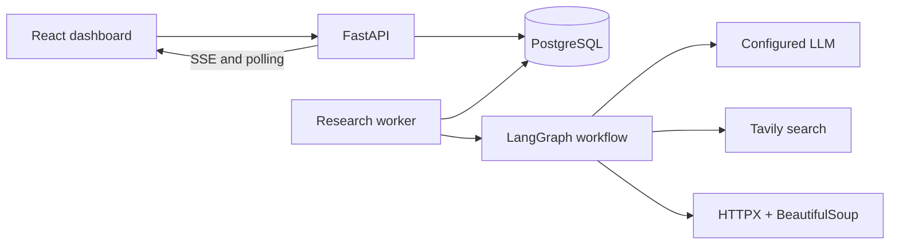
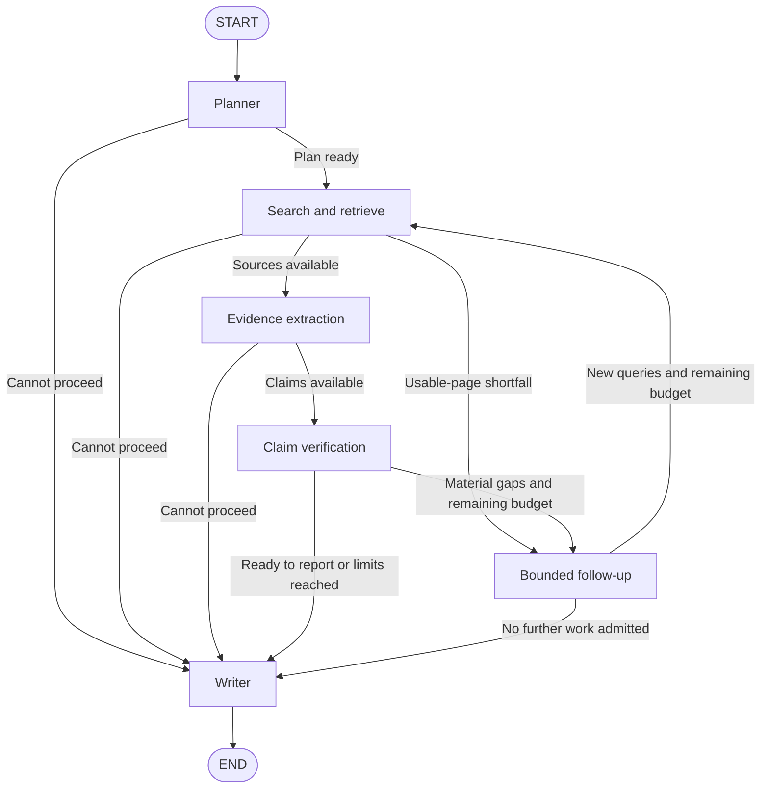

# DeepResearch AI

**An evidence-grounded, multi-agent research assistant that makes its sources and limitations visible.**

DeepResearch AI turns a research question into a plan, retrieves web sources,
extracts exact supporting passages, and checks claims before composing a cited
answer. A React dashboard provides private research history, live progress, and
report downloads; FastAPI and a separate durable worker handle execution.

Built with **Python, LangGraph, LangChain, FastAPI, React, TypeScript, and PostgreSQL**.

[Quick start](#quick-start) | [Architecture](#architecture) | [Evidence and report quality](#evidence-and-report-quality) | [API](#api) | [Testing](#testing) | [Documentation](#documentation)

## Why this project

A fluent answer is not enough to establish that its citations exist or support
its claims. DeepResearch AI keeps the research trail explicit: original URLs,
stable source IDs, retrieved passages, claim-level judgments, and unresolved gaps.

The project demonstrates an AI application beyond a chat interface: typed agent
contracts, bounded graph execution, safe retrieval, durable jobs, relational
storage, user isolation, and testable failure handling.

## Capabilities

- **Five research agents:** planning, search, evidence extraction, verification, and writing, coordinated through a sequential LangGraph workflow.
- **Three research depths:** Quick, Standard, and Deep, with bounded searches, page requests, model calls, elapsed time, and token reservations.
- **Evidence-grounded answers:** exact-passage validation, citation checks, supported/contradicted/insufficient claim judgments, and explicit uncertainty.
- **Useful partial results:** supported findings remain visible when some requested details cannot be established. Source-specific examples and optional gaps are separated from the main answer.
- **Durable execution:** a database-backed queue, worker leases, versioned checkpoints, saved provider responses, cancellation, and explicit safe resume.
- **Private workspaces:** email/password accounts, user-owned history, search and filters, individual research deletion, and password-confirmed account deletion.
- **Operational visibility:** live server-sent events with polling fallback, personal usage and quotas, an administrator dashboard, Markdown downloads, and account ZIP exports.
- **Offline development:** deterministic mock models, search results, and retrieved content, without provider credentials or external provider requests.

## Architecture



The API validates a submission, commits a queued run, and returns its unique ID.
The worker claims the job and executes research outside the HTTP request
lifecycle. Progress, sources, evidence, and results are persisted as work proceeds.
Database-backed jobs are distinct from in-memory HTTP background tasks.

### Research workflow



| Component | Responsibility |
| --- | --- |
| Planner | Produces a structured plan and focused search queries. |
| Search | Uses Tavily, deduplicates canonical URLs, and retrieves usable public pages. |
| Evidence | Extracts scoped claims and exact passages tied to recorded source IDs. |
| Verification | Assesses every supplied passage against each claim, preserving contradiction and missing support. |
| Writer | Composes readable paragraphs from already verified claim statements and assigns citations. |
| Follow-up control | Requests replacement sources or targeted research within the original run limits. |

The Writer makes **no additional LLM call**. It does not introduce new factual
statements or invent connecting explanations. The graph is sequential; it does
not run parallel research workers inside an investigation.

### Technology stack

| Layer | Technologies |
| --- | --- |
| Research | Python 3.11+, LangGraph, LangChain, Pydantic |
| Model integrations | OpenAI; optional Google Gemini and Anthropic adapters |
| Search and retrieval | Tavily, HTTPX, BeautifulSoup |
| Backend | FastAPI, Uvicorn, server-sent events |
| Frontend | React, TypeScript, Vite |
| Persistence | PostgreSQL, SQLAlchemy, Alembic |
| Authentication | Argon2id password hashing, opaque cookie sessions, CSRF protection |
| Testing | pytest, Vitest, React Testing Library |

## Quick start

The examples use **Windows PowerShell**. Run commands from the repository root
unless a step says otherwise. Calling the virtual environment's Python directly
avoids changing PowerShell's activation policy.

### Prerequisites

- Python **3.11+**; the commands below use Python **3.13**. Adjust the launcher version if needed.
- Node.js **22.13+ on the 22.x line, or 24+**, with npm.
- PostgreSQL **15+** binaries for persistent application storage. The isolated offline demo below does not require PostgreSQL.

### 1. Install dependencies

```powershell
py -3.13 -m venv .venv
.\.venv\Scripts\python.exe -m pip install -e ".[dev]"
if (-not (Test-Path -LiteralPath .env)) { Copy-Item .env.example .env }

cd frontend
npm.cmd ci
cd ..
```

The example environment enables `MOCK_MODE=true`. Existing `.env` files are
preserved. Keep provider credentials in the backend environment; never add them
to frontend code or `VITE_` variables.

### 2. Try the isolated offline demo

Build the dashboard, then launch the demo:

```powershell
cd frontend
npm.cmd run build
cd ..
.\.venv\Scripts\python.exe scripts/local_demo.py --serve --port 8001
```

Open **http://127.0.0.1:8001** and register a temporary account to explore the
interface. The demo starts its own backend and worker, uses temporary SQLite
storage, and strips provider credentials from child processes. Press **Ctrl+C**
to stop it and remove its temporary database.

For an automated HTTP demonstration that exits and cleans up its processes:

```powershell
.\.venv\Scripts\python.exe scripts/local_demo.py
```

This writes a sanitized `demo_report.md`. Mock research uses fixed, labeled RAG
sample data, not live research about arbitrary topics.

### 3. Set up persistent PostgreSQL storage

The optional helper creates a separate project-local cluster on
**127.0.0.1:55432**. It generates credentials and saves `DATABASE_URL` privately in
`.env`. Its default binary directory is `C:\Program Files\PostgreSQL\15\bin`;
use `--pg-bin` for another installation.

```powershell
# Initialize once on a new checkout; preserve an existing cluster.
if (-not (Test-Path -LiteralPath data/postgres/PG_VERSION)) {
    .\.venv\Scripts\python.exe scripts/postgres_local.py init
}

.\.venv\Scripts\python.exe scripts/postgres_local.py start
.\.venv\Scripts\python.exe -m deepresearch_ai.db upgrade
```

If the project cluster is already running, skip `start`. To use another
PostgreSQL database, set its `postgresql+psycopg://...` connection URL privately in
`.env`, skip the local helper, and run the migration command.

### 4. Start the application

Open **three terminals at the repository root**. Use the same database and mock/real
mode in both Python processes.

**Terminal 1: backend**

```powershell
$env:MOCK_MODE = "true"
.\.venv\Scripts\python.exe -m uvicorn deepresearch_ai.api.app:create_app --factory --host 127.0.0.1 --port 8000
```

**Terminal 2: research worker**

```powershell
$env:MOCK_MODE = "true"
.\.venv\Scripts\python.exe -m deepresearch_ai.worker
```

**Terminal 3: React dashboard**

```powershell
cd frontend
npm.cmd run dev
```

Open **http://127.0.0.1:5173**, create an account, and start a research run.
Interactive API documentation is available at **http://127.0.0.1:8000/docs**.
A queued run needs the worker process to make progress.

For a single-origin local build, run `npm.cmd run build` inside `frontend` and
start the backend from the repository root. FastAPI serves `frontend/dist` at
**http://127.0.0.1:8000**. The worker still runs separately.

To stop, press **Ctrl+C** in each application terminal. Then stop the project
cluster if it is no longer needed:

```powershell
.\.venv\Scripts\python.exe scripts/postgres_local.py stop
```

## Live provider configuration

Real research needs both a selected LLM credential and a Tavily key. Supported
model adapters are:

| `LLM_PROVIDER` | Credential | Installation |
| --- | --- | --- |
| `openai` | `OPENAI_API_KEY` | Included in the base dependencies |
| `google_genai` | `GOOGLE_API_KEY`, or `GEMINI_API_KEY` as fallback | `pip install -e ".[dev,gemini]"` |
| `anthropic` | `ANTHROPIC_API_KEY` | `pip install -e ".[dev,anthropic]"` |

For example, install the Gemini integration using the project environment:

```powershell
.\.venv\Scripts\python.exe -m pip install -e ".[dev,gemini]"
```

Edit `.env`, replace the model placeholder with one enabled for your account, and
enter the two credentials locally:

```dotenv
MOCK_MODE=false
LLM_PROVIDER=google_genai
LLM_MODEL=your-gemini-model-id
LLM_TEMPERATURE=
GOOGLE_API_KEY=
SEARCH_PROVIDER=tavily
TAVILY_API_KEY=
```

Blank `LLM_TEMPERATURE` uses the provider default. Optional reasoning settings
must be compatible with the chosen model. Model access, billing, and provider
limits depend on your account.

Override the mock setting in **both** Python terminals before restarting them:

```powershell
$env:MOCK_MODE = "false"
```

Environment variables take precedence over `.env`. Restart the backend and worker
after configuration changes. Real mode reports provider failures explicitly;
it does not silently substitute mock results.

### Selected controls

See [`.env.example`](.env.example) for the complete configuration reference.

| Setting | Default | Purpose |
| --- | --- | --- |
| `RESEARCH_MAX_PAGES` | `5` | Maximum usable pages per investigation |
| `RESEARCH_MAX_PAGE_ATTEMPTS` | `15` | Run-wide page request allowance |
| `RESEARCH_MAX_RETRIES` | `2` | Maximum follow-up rounds for unresolved high-priority claims |
| `RESEARCH_MAX_SOURCE_RETRIES` | `2` | Replacement-source follow-up rounds |
| `RESEARCH_MAX_CONTENT_CHARS` | `8000` | Maximum retained text characters per page |
| `RESEARCH_MAX_LLM_CALLS` | `16` | Model-attempt ceiling, including retries |
| `RESEARCH_MAX_SEARCHES` | `12` | Search-attempt ceiling |
| `RESEARCH_MAX_ELAPSED_SECONDS` | `180` | Run processing-time limit |
| `RESEARCH_MAX_TOKENS` | `200000` | Conservative local token reservations, settled when complete provider usage is available |
| `PROVIDER_MAX_RETRIES` | `1` | Additional attempts for transient model/search failures |
| `QUOTA_DAILY_RUNS` | `20` | Daily submissions per user |
| `QUOTA_DAILY_TOKENS` | `1000000` | Daily per-user token allowance |
| `QUOTA_MAX_ACTIVE_RUNS` | `3` | Active investigations per user |

Depth profiles cap the configured global limits:

| Depth | Usable pages | Claim follow-ups | Processing time |
| --- | --- | --- | --- |
| Quick | Up to 3 | 0 | Up to 90 seconds |
| Standard | Up to 5 | 1 | Up to 180 seconds |
| Deep | Configured ceiling; default 5 | Configured ceiling; default 2 | Configured ceiling; default 180 seconds |

These are limits, not latency promises. Follow-ups require remaining source
capacity, time, and provider budgets. Optional estimated-cost limits require
explicit account-specific price inputs; usage estimates are not provider invoices.

## Evidence and report quality

Every accepted evidence excerpt must occur verbatim in a recorded source. Source
IDs are derived from original URLs; claim and passage IDs remain stable across
research rounds. Citations resolve only to retrieved source IDs.

Verification checks the complete claim-by-passage matrix, including irrelevant
and contradictory passages. One bounded format-repair attempt can request
missing judgments. Incomplete judgments never establish support.

| Report status | Meaning |
| --- | --- |
| `complete` | Coverage was judged adequate, selected claims are supported, and evidence, execution, and budget checks passed. |
| `partial` | Checked findings from at least two cited sources answer part of the question, with unresolved coverage or claim gaps. |
| `insufficient_evidence` | Too little checked support, only contextual examples, or failed integrity, execution, or budget checks. |

The findings contain verified claim statements with citations. Exact passages
and individual judgments remain available in **Evidence**. Off-topic drafts are
filtered, source-specific examples retain their scope, and unresolved claims
are labeled rather than presented as facts.

A run marked `completed` has finished processing; its report status separately
indicates evidence quality. Semantic support, relevance, and coverage are LLM
assessments. They do not independently establish source credibility or factual
truth, and multiple URLs do not guarantee independent corroboration.

## Persistence, recovery, and security

PostgreSQL stores normalized users, sessions, runs, plans, sources, immutable
source snapshots, evidence, verification results, reports, and usage records.
Foreign keys and transactional writes enforce relationships. Versioned execution
checkpoints and provider receipts are operational snapshots, separate from the
normalized report data.

- Worker leases fence late writes after cancellation or ownership loss.
- Resume reuses completed steps and saved responses within the original limits.
- Unknown paid-request outcomes block automatic replay because they may already have been billed.
- Cookie sessions, Argon2id passwords, CSRF checks, and ownership-scoped queries protect private workspaces.
- Retrieval blocks private-network destinations and unsafe redirects, checks site restrictions, and bounds download size and time.
- Retrieved pages are treated as untrusted data. Citation validation and passage checks remain separate from model instructions.
- Rendered reports block raw HTML, remote images, and arbitrary links. Provider credentials remain on the backend.

Administrator access requires an explicit local grant after the account exists:

```powershell
.\.venv\Scripts\python.exe -m deepresearch_ai.db set-admin --email "your-registered-email@example.com"
```

This is a portfolio application with implemented reliability controls. Public
deployment still needs the operational work in the
[production-readiness checklist](PRODUCTION_READINESS_CHECKLIST.md), including
HTTPS, deployment configuration, backup/restore procedures, and account recovery.

## CLI

The CLI runs research directly and does not require the web application or a
database. Durable history and resume belong to worker-managed runs.

```powershell
# Credential-free example
$env:MOCK_MODE = "true"
.\.venv\Scripts\python.exe -m deepresearch_ai smoke
.\.venv\Scripts\python.exe -m deepresearch_ai research "How does retrieval-augmented generation ground an LLM response?"

# Structured report
.\.venv\Scripts\python.exe -m deepresearch_ai research "How does retrieval-augmented generation ground an LLM response?" --max-pages 3 --format json

# Preserved original single-agent pipeline
.\.venv\Scripts\python.exe -m deepresearch_ai research "How does retrieval-augmented generation ground an LLM response?" --workflow single
```

Exit code `0` means a report was produced, including a partial or insufficient
evidence report; `2` indicates configuration/input errors; `1` indicates an
unexpected execution failure. The legacy single workflow retains its original
extractive-summary behavior rather than the graph's claim-verification process.

## API

All research endpoints require authentication. Mutating requests also require
the session's `X-CSRF-Token`. The dashboard handles session cookies and tokens.

| Method | Endpoint | Purpose |
| --- | --- | --- |
| `POST` | `/research` | Queue an investigation; returns `202` and its run ID |
| `GET` | `/research` | List owned history with search, filters, and pagination |
| `GET` | `/research/{id}` | Retrieve status, progress, and available results |
| `GET` | `/research/{id}/sources` | Retrieve recorded sources |
| `GET` | `/research/{id}/report` | Retrieve the structured report |
| `GET` | `/research/{id}/report.md` | Download sanitized Markdown |
| `GET` | `/research/{id}/events` | Receive authenticated live progress events |
| `POST` | `/research/{id}/cancel` | Cancel queued or running work |
| `POST` | `/research/{id}/resume` | Resume a compatible, safely resumable failed run |
| `DELETE` | `/research/{id}` | Delete an owned investigation |

Example authenticated submission body:

```json
{
  "topic": "How does retrieval-augmented generation ground an LLM response?",
  "instructions": "Explain the evidence and important limitations.",
  "depth": "standard"
}
```

Run states are `queued`, `running`, `completed`, `failed`, and `cancelled`.
An optional `Idempotency-Key` protects submission retries; matching active
submissions are also deduplicated per user.

Authentication is under `/auth`; account usage and ZIP export are under
`/account`; administrator summaries are under `/admin`. See the running
[OpenAPI documentation](http://127.0.0.1:8000/docs) for complete contracts.

## Testing

Latest recorded local validation, **11 November 2026**:

| Suite | Passing tests |
| --- | ---: |
| Backend: models, agents, graph, API, security, and recovery | 537 |
| PostgreSQL integration | 10 |
| React components and client behavior | 59 |
| **Total** | **606** |

The TypeScript/Vite production build and isolated HTTP/worker demo also passed.
These checks use mocked LLM/search providers; they do not measure live provider
availability, factual accuracy, production throughput, or cost savings.

Run the backend suite:

```powershell
.\.venv\Scripts\python.exe -m pytest -q
.\.venv\Scripts\python.exe -m pip check
```

Run frontend checks:

```powershell
cd frontend
npm.cmd test
npm.cmd run build
cd ..
```

PostgreSQL tests are opt-in through `TEST_POSTGRES_URL`. They migrate disposable
schemas on the project-local instance at port `55432`, then remove only those
schemas. Default backend tests use temporary SQLite databases and block provider
network calls. See the [database guide](docs/auth_postgres.md) for setup details.

Coverage includes fabricated citations, non-verbatim passages, conflicting
evidence, prompt injection, unsafe URLs and redirects, timeouts, provider
failures, bounded research loops, user isolation, quotas, and checkpoint replay.

## Project structure

```text
.
|-- src/deepresearch_ai/
|   |-- agents/          # Planner, search, evidence, verification, writer, retry
|   |-- api/             # HTTP routes, authentication, live events
|   |-- config/          # Environment settings and logging
|   |-- graph/           # Typed state and conditional LangGraph workflow
|   |-- models/          # Validated research, account, and API contracts
|   |-- services/        # Provider adapters, retrieval, budgets, presentation
|   |-- storage/         # Repositories, normalized tables, accounting, recovery
|   |-- tools/           # Reserved tool extension package
|   |-- cli.py           # Standalone smoke and research commands
|   |-- db.py            # Migrations and explicit operator commands
|   `-- worker.py        # Durable research-job consumer
|-- frontend/            # React + TypeScript dashboard and Vitest tests
|-- migrations/          # Alembic revisions
|-- tests/               # Backend and opt-in PostgreSQL tests
|-- scripts/             # Local database helper and isolated demo
|-- docs/                # Architecture, behavior, and operational guides
|-- .env.example         # Configuration template; contains no credentials
|-- pyproject.toml       # Python dependencies and package entry points
`-- PRODUCTION_READINESS_CHECKLIST.md
```

## Troubleshooting

| Symptom | Check |
| --- | --- |
| A run stays queued | Start the worker; confirm it uses the same database as the API. |
| Missing API-key error | Check the selected provider and saved `.env`, or enable mock mode in both Python processes. |
| Provider HTTP `503` | The provider reported temporary unavailability; bounded retries may still fail. |
| Provider HTTP `429` | Review that provider account's rate or quota limits. |
| Local budget reached | Review research depth and configured run/account limits; these differ from provider quotas. |
| Partial or insufficient report | Inspect unresolved claims, source judgments, coverage, and uncertainty rather than source count alone. |
| Resume blocked | A checkpoint is incompatible or a paid call has an unknown outcome; inspect the reported reason. |
| Old behavior after an update | Restart both Python processes and refresh Vite, or rebuild the bundled frontend. Historical reports retain their saved contents. |

## Documentation

- [Report quality and status rules](docs/report_quality.md)
- [PostgreSQL, normalized schema, and local accounts](docs/auth_postgres.md)
- [Account controls, usage quotas, and duplicate prevention](docs/account_features.md)
- [Checkpoint recovery, live events, administration, and exports](docs/recovery_operations.md)
- [Dashboard development and bundled serving](docs/dashboard.md)
- [API and worker design](docs/phase5.md)
- [Evidence verification and bounded retries](docs/phase4.md)
- [Generated research graph](docs/research_graph.md)
- [Production-readiness checklist](PRODUCTION_READINESS_CHECKLIST.md)
