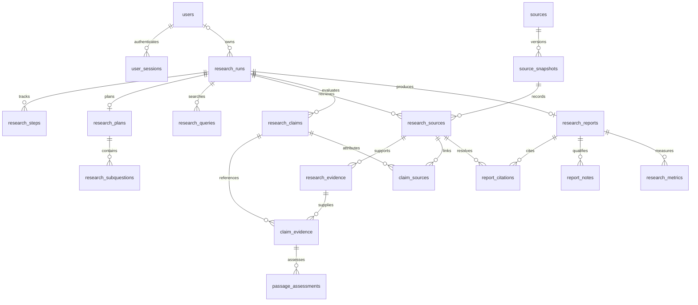

# PostgreSQL, normalized storage, and local accounts

The web application now uses PostgreSQL and local email/password accounts.
The existing LangGraph pipeline and standalone CLI are preserved. Provider keys
belong only in the backend `.env`; registration never asks for them.

See [account and research controls](account_features.md) for deletion, usage,
daily quotas, history search and idempotent submissions.

## Start on this machine

The project-local PostgreSQL 15 instance has already been initialized and migrated
at **127.0.0.1:55432**, database `deepresearch`. Its generated connection credential
is saved in `.env`. The installed PostgreSQL Windows service is separate and was
not modified. No application server is started automatically.

From `C:\Users\Ankit\Desktop\Project`:

```powershell
# Start the project's database before the API and worker.
.\.venv\Scripts\python.exe scripts/postgres_local.py start
.\.venv\Scripts\python.exe -m deepresearch_ai.db upgrade
```

Then use three terminals, each starting from the project root:

```powershell
# Terminal 1: backend. Override mock mode for credential-free development.
$env:MOCK_MODE = "true"
.\.venv\Scripts\python.exe -m uvicorn deepresearch_ai.api.app:create_app --factory --host 127.0.0.1 --port 8000

# Terminal 2: research worker.
$env:MOCK_MODE = "true"
.\.venv\Scripts\python.exe -m deepresearch_ai.worker

# Terminal 3: React dashboard.
cd frontend
npm.cmd ci
npm.cmd run dev
```

Open <http://127.0.0.1:5173>, choose **Create an account**, and register with an
email address and a passphrase of 15–128 characters. Registration signs you in.
Only that account's research is visible. For real research, remove the mock
override or set it to `false` in both Python terminals and restart them. Existing
provider quotas still apply.

Alternatively, `cd frontend; npm.cmd run build` builds the dashboard for the API
to serve at <http://127.0.0.1:8000>; return to the project root before starting the
backend. The worker still runs separately.

Stop the API/worker/Vite with Ctrl+C in their terminals, then:

```powershell
.\.venv\Scripts\python.exe scripts/postgres_local.py stop
```

## First setup on a new checkout

Install PostgreSQL 15+ binaries, Python dependencies and frontend dependencies.
Keep an existing `.env`; copy `.env.example` only if `.env` is absent. Then:

```powershell
.\.venv\Scripts\python.exe -m pip install -e ".[dev]"
.\.venv\Scripts\python.exe scripts/postgres_local.py init
.\.venv\Scripts\python.exe scripts/postgres_local.py start
.\.venv\Scripts\python.exe -m deepresearch_ai.db upgrade
```

The helper defaults to `C:\Program Files\PostgreSQL\15\bin`; use `--pg-bin` for
another installation. `init` generates separate admin/application credentials,
restricts credential-file permissions, writes `DATABASE_URL`, and stops its
cluster after setup. Cluster files, local logs and secrets live in ignored
`data/`. Do not delete this directory if you want to keep your history.
For another PostgreSQL host, supply a `postgresql+psycopg://...` URL privately in
`.env` and run migrations; the local helper is optional.

## Schema normalization

The database stores entities and relationships in separate tables instead of
embedding sources, evidence and reports inside JSON columns. Foreign keys,
composite keys, uniqueness constraints and transactional writes enforce integrity.



- **Source identity** stores the stable source ID and original URL once.
  Retrieval snapshots store content, title, resolved URL and dates. Each run links
  to its own snapshot, preserving what was retrieved even when a page later changes.
- **Evidence and citations** reference sources in the same run using composite
  foreign keys. Claims connect to evidence and supporting/contradicting sources
  through association tables; passage assessments retain the explanations.
- **Reports** store their rendered Markdown and scalar metadata. Plans, queries,
  notes, stage statuses and usage measurements live in child tables. JSON remains
  the external API format; it is assembled from relational data on reads.
- **Accounts** have unique normalized emails (trimmed and casefolded), Argon2id
  password hashes, and separate session records. Passwords are never normalized.

Rendered Markdown, progress and content fingerprints are deliberate stored
artifacts, rather than substitutes for the normalized entity relationships.
SQLAlchemy provides the repository boundary; Alembic supplies versioned migrations.
PostgreSQL startup checks the migration version rather than silently calling
`create_all()`. SQLite is retained only as an explicit isolated test/demo adapter.

## Existing research history

The six saved runs were copied from `data/deepresearch.db` into PostgreSQL without
changing the original file. IDs, reports, source text and recorded dates are
preserved. Imported records are **unassigned**: signing up never exposes old
research to the first account that registers.

After creating your account, explicitly assign the legacy history locally:

```powershell
.\.venv\Scripts\python.exe -m deepresearch_ai.db assign-legacy --email "your-account@example.com"
```

Refresh the dashboard history afterward. This administrator command assigns all
currently unowned imported runs; it does not transfer another user's owned runs.
To repeat the import if needed:

```powershell
.\.venv\Scripts\python.exe -m deepresearch_ai.db import-sqlite data/deepresearch.db
```

Import reads SQLite in read-only mode and skips IDs already present. Interrupted
queued/running legacy jobs become failed, so importing history cannot replay paid
calls. Validation failures roll back the entire import.

## Authentication and API clients

Sessions use random opaque cookies with HttpOnly and SameSite=Lax. Only a SHA256
digest is stored in PostgreSQL. Login rotates the session; logout revokes it;
sessions expire after `AUTH_SESSION_HOURS` (12 by default). Private API queries
include the authenticated user ID in SQL, and other users' IDs return 404.

Browser mutations require `X-CSRF-Token` and an allowed Origin when supplied:

1. `GET /auth/csrf` obtains a short-lived pre-login cookie and CSRF token.
2. `POST /auth/register` (`name`, `email`, `password`) or `/auth/login` (`email`,
   `password`) sends that token and cookie. The response contains public user
   details and a session-bound CSRF token.
3. Reuse the session cookie on all research requests. Send the session CSRF token
   on `POST /research`, cancellation, and `POST /auth/logout`.
4. `GET /auth/me` restores the session after a page refresh.

The React client handles these steps, keeps the CSRF token only in memory and
clears private views when a session expires. Cookies are not exposed to JavaScript.
Authentication attempts are throttled in PostgreSQL; 429 returns `Retry-After`.
Research/auth responses use `Cache-Control: no-store` and safe error envelopes.
Vite proxies `/auth`, `/research` and `/health`, preserving the same browser origin.

For HTTPS deployment, set `APP_ENV=production`, `AUTH_COOKIE_SECURE=true`, and
`AUTH_ALLOWED_ORIGINS` to the exact HTTPS dashboard origin(s) as a JSON array.
Secure mode uses `__Host-` cookie names. Configure trusted proxy forwarding
explicitly; never trust arbitrary client-provided forwarded IP headers. Set
`AUTH_ALLOW_REGISTRATION=false` after creating accounts for a private deployment.

This provides local accounts, not a complete public identity platform. Email
verification, self-service password recovery, MFA, production TLS, backup/restore
operations and deployment hardening remain separate work. Database access still
requires protecting the machine and `.env`.

## Verification

```powershell
.\.venv\Scripts\python.exe -m pytest -q
.\.venv\Scripts\python.exe -m pip check
cd frontend
npm.cmd test
npm.cmd run build
```

`tests/test_postgres.py` is opt-in via `TEST_POSTGRES_URL` pointing to the local
55432 instance. It migrates a random isolated schema, tests login and the full
mock worker/report flow, verifies concurrent claims and metadata, then drops only
that test schema. Default tests use temporary SQLite and mocked providers.
`scripts/local_demo.py` uses real local HTTP, a temporary account/database and a
separate mock worker, then shuts down its own processes. It never calls paid APIs.

Main files: `storage/tables.py` defines the schema; `storage/report_store.py`
maps report models to rows; `storage/sql.py` handles jobs and scoped reads;
`storage/auth.py` stores accounts/sessions/throttles; `api/auth.py` defines login,
cookie and CSRF behavior; `migrations/` contains the Alembic revision;
`storage/legacy.py` imports old history; `frontend/src/components/AuthView.tsx`
provides the login/register screen. Ship `migrations/` and `alembic.ini` alongside
the source deployment, just as the built frontend is shipped alongside the API.
