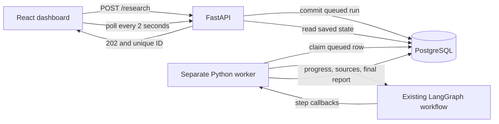

# Phase 5: backend API, React dashboard, and persistent history

The existing LangGraph service has an HTTP API, a React dashboard, and PostgreSQL
history with local email/password accounts. The original `smoke`, `research`,
and `--workflow single` CLI commands remain available. See the
[database and accounts guide](auth_postgres.md) for the current setup, normalized
schema, login and legacy import details. Local commands bind to `127.0.0.1`.

## Start locally

Run every terminal from the repository root so API and worker use the same `.env`
and PostgreSQL database. Update the existing virtual environment:

```powershell
.\.venv\Scripts\python.exe -m pip install -e ".[dev]"
# For real Gemini, also install its optional integration if necessary:
.\.venv\Scripts\python.exe -m pip install -e ".[gemini]"
```

Your existing `.env` was preserved. New settings default to:

```dotenv
# scripts/postgres_local.py init writes a generated credential to .env.
DATABASE_URL=postgresql+psycopg://deepresearch@127.0.0.1:55432/deepresearch
FRONTEND_DIST_DIR=frontend/dist
WORKER_POLL_SECONDS=1
WORKER_LEASE_SECONDS=60
```

Start PostgreSQL and run migrations first:

```powershell
.\.venv\Scripts\python.exe scripts/postgres_local.py start
.\.venv\Scripts\python.exe -m deepresearch_ai.db upgrade
```

Use three terminals for the full interface. These commands deliberately use
mock research for a credential-free local run.

**Terminal 1: backend**

```powershell
$env:MOCK_MODE = "true"
.\.venv\Scripts\python.exe -m uvicorn deepresearch_ai.api.app:create_app --factory --host 127.0.0.1 --port 8000
```

Interactive API documentation: <http://127.0.0.1:8000/docs>.

**Terminal 2: worker**

```powershell
$env:MOCK_MODE = "true"
.\.venv\Scripts\python.exe -m deepresearch_ai.worker
# Equivalent installed command: .\.venv\Scripts\deepresearch-worker.exe
```

**Terminal 3: frontend**

```powershell
cd frontend
npm.cmd ci
npm.cmd run dev
```

Open <http://127.0.0.1:5173> and create an account or sign in. See the [React dashboard guide](dashboard.md) for built serving and the interactive offline demo. Enter a topic such as **How does RAG ground an
answer?**, add optional instructions, choose Quick/Standard/Deep, and click
**Start research**. Progress refreshes every two seconds. Completion shows a
readable report, a separate Sources tab with clickable public HTTP(S) URLs, and a
Markdown download. History is paginated and remains available after restart.

To run real research, set `MOCK_MODE=false` in the **worker's environment** and
configure your LLM and Tavily keys in `.env`. Remove any PowerShell mock override
with `Remove-Item Env:MOCK_MODE`, or set it explicitly to `false`. Research uses
the worker's current settings when it claims the job; settings and secrets are
not copied into stored jobs. Stop a mock worker before replacing it with a real
worker. Provider usage can incur charges. The UI never asks for provider keys.

## Durable worker mechanism



`POST /research` commits a queued row and returns immediately. No FastAPI
`BackgroundTasks`, request thread, or in-memory queue executes research. API
endpoints perform only short database operations. The worker is a separate
long-lived command with its own process lifecycle and no dependence on an HTTP
request remaining open.

Each job follows one of these transitions:

```text
queued -> running -> completed
                  -> failed
queued/running    -> cancelled
```

UUIDs identify runs. An atomic conditional update claims a queued row; competing
workers cannot both claim it. Every progress/final write requires the same
owner token, running state, and unexpired lease. The heartbeat renews that lease
on a separate thread, even while the synchronous graph waits on a provider.
Sources are saved after search, before the final report exists.

Queued jobs survive process restarts. An abandoned running job becomes failed
when its lease expires; worker polling and API history/status reads detect this.
It is **not automatically replayed**, because replaying provider requests can
repeat paid calls. A new submission explicitly retries the work. Safe failed runs can now resume explicitly using durable node checkpoints and
provider receipts; unknown paid-call outcomes block replay. See the
[recovery guide](recovery_operations.md).

Cancellation is persistent and immediately visible. The worker stops at its next
agent or state-update boundary. It cannot forcibly interrupt an already-running
SDK call, but a late result cannot overwrite a cancelled/expired job. Previously
saved sources remain accessible. A completed run can contain an
`insufficient_evidence` report: completion means the workflow returned a report,
not that the question was conclusively answered. Unexpected failures or missing
provider configuration produce a failed run with a safe error message.

The queue is durable for this local MVP; it is not advertised as a production
job platform. Start one worker by default. For deployment, supervise the API and
worker separately with a process manager, configure HTTPS, backups and trusted proxy settings, and evaluate a dedicated
job broker for the deployment. Accounts and versioned migrations are implemented. There is no automatic
process manager or production message broker in Phase 5.

## Depth and limits

Acquisition update validation: **438 tests passed**. The isolated local HTTP
demo completed with two cited mock sources and healthy frontend; graph and
legacy single CLI checks also passed. A separate real acquisition-only check
reused the saved plan for run `776365ba-213d-485e-b61d-bc3452dd64e7`: it retrieved
five distinct pages in twelve download attempts and four search calls under
Standard limits, with no LLM calls. This verifies retrieval, not the quality or
completion of a newly generated report.

All depth values are capped by the existing environment settings. Deep uses the
full configured ceiling; it does not silently increase permitted spending.

| Limit | Quick | Standard | Deep |
| --- | --- | --- | --- |
| Usable pages retained | up to 3 | up to 5 | configured ceiling, default 5 |
| Download attempts | up to 6 | up to 12 | configured ceiling, default 15 |
| Source follow-up rounds | up to 1 | up to 2 | configured ceiling, default 2 |
| Claim research rounds | 0 | up to 1 | configured ceiling, default 2 |
| LLM attempts | up to 6 | up to 12 | configured ceiling, default 16 |
| Search attempts | up to 4 | up to 9 | configured ceiling, default 12 |
| Elapsed seconds | up to 90 | up to 180 | configured ceiling, default 180 |
| Reserved tokens | up to 60000 | up to 150000 | configured ceiling, default 200000 |

Existing cost, output-token, timeout, source-size, and network restrictions apply
to every profile. Progress is an estimate based on steps and the possible retry
rounds. It can jump to 100% when research finishes early. `current_step`,
`iteration`, and `step_status` provide the precise logical position.

The graph targets at least two successfully downloaded, distinct pages before
evidence extraction. Failed downloads no longer fill usable-page slots. When
results run out below that target, it generates two fresh topic-based queries
without another LLM call and returns to search. Attempted canonical URLs and
previous queries are remembered across all rounds. Both kinds of follow-up share
the same search, download, elapsed-time, and cost budgets.

The target is best effort: blocked sites, empty results, and exhausted budgets
can still leave fewer pages. The report then records the shortfall and counters.
Two downloaded pages do not guarantee two sources with supported evidence;
extraction and verification still run independently. A Gemini outage can still
prevent a supported report. An explicit CLI `--max-pages 1` is respected and
cannot meet the report's two-source requirement.

Optional instructions remain separate from the topic in `ResearchRequest` and
are passed as data to planning, evidence extraction, verification, and retry
planning. They do not replace system instructions or evidence requirements.

## API contract

| Endpoint | Result |
| --- | --- |
| `POST /research` | 202, queued run metadata, unique ID, and `Location` header |
| `GET /research/{id}` | Run status, current step, progress, and optional completed report |
| `GET /research/{id}/sources` | Persisted source documents, including partial results |
| `GET /research/{id}/report` | Structured completed report; 409 until available |
| `GET /research?limit=20&offset=0` | Newest-first history: items, total, limit, offset |
| `POST /research/{id}/cancel` | Cancel queued/running work; repeated cancellation is safe |
| `GET /research/{id}/report.md` | Sanitized Markdown attachment with cited sources and dates |
| `GET /health` | Database connectivity/readiness |

Research endpoints require a session cookie; mutations also require
`X-CSRF-Token`. The dashboard handles this automatically. Script clients must
follow the [authentication sequence](auth_postgres.md#authentication-and-api-clients).
Anonymous access returns 401, cross-user research IDs return 404, and invalid
CSRF tokens return 403.

Unknown runs return 404, invalid inputs return 422, unavailable reports and
invalid state transitions return 409, storage failures return 503, and unexpected
failures return 500. All use the same envelope:

```json
{"error":{"code":"report_not_ready","message":"A completed report is not available for this run.","details":[]}}
```

Validation details identify fields and error types without echoing raw inputs.
Raw provider exceptions, settings, ownership tokens, database URLs, and API keys
are excluded from public responses. Backend request logs omit request bodies.

## Persistence and PostgreSQL boundary

`storage/base.py` defines the worker-facing `RunRepository` protocol. The API
factory wires run and authentication repositories to the same SQLAlchemy engine;
endpoints use repository methods. `storage/sql.py` implements short transactions
and foreign keys, with WAL/busy-timeout settings only for explicit SQLite tests.
The API and heartbeat never share a mutable ORM session.

PostgreSQL is the default runtime database. Runs, steps, plans, sources,
retrieval snapshots, reports, evidence, claims and citation relationships are
stored in normalized tables with foreign keys; reports are reconstructed as
Pydantic models for the API. Accounts, hashed sessions and authentication
rate-limit buckets are separate tables. No provider credentials are persisted.

Alembic migrations must run before the API and worker start. PostgreSQL workers
claim jobs with `FOR UPDATE SKIP LOCKED` plus conditional state updates. The old
SQLite file is preserved as import input; explicit temporary SQLite databases
remain supported for tests and isolated demos. See the
[schema and migration guide](auth_postgres.md#schema-normalization).

## Rendering safety

Report Markdown is parsed with raw HTML disabled and passed through an HTML tag
and attribute allowlist. Scripts, frames, styles, remote images, and event
handlers cannot execute/load from report content. Report links must match a
recorded source URL and pass public HTTP(S) syntax validation. Unsafe source
links are omitted, and source titles are rendered as plain text. Source-link
validation does not perform DNS resolution or guarantee the destination site's
future behavior.

React renders Markdown with raw HTML skipped and images disabled. Link targets
must match safe recorded source URLs; source titles are rendered as text.
Downloads rebuild Markdown from the backend-sanitized view rather
than returning unchecked model Markdown. API JSON remains structured research
data; external clients must apply their own safe rendering.

## Files

- `api/app.py`: FastAPI factory, endpoints, validation, safe errors, and responses.
- `models/runs.py`: shared run states, depth, request, metadata, and history models.
- `storage/base.py`, `storage/sql.py`: repository boundary, SQL persistence, and leases.
- `worker.py`: standalone queue consumer, heartbeat, cancellation, and graph callbacks.
- `services/depth.py`: research depth caps; `services/presentation.py`: sanitized rendering/export.
- `frontend/src/api.ts`, `hooks.ts`, `App.tsx`, `components/`: typed API client, polling, and React views.
- `scripts/local_demo.py`: isolated local HTTP/process demo and optional persistent offline dashboard.
- `tests/test_api.py`, `tests/test_dashboard.py`, `tests/test_frontend.py`: API/worker integration, static-serving isolation, and sanitization.
- `frontend/src/test/`: React submission, polling, reports, history, cancellation, downloads, and unsafe-content checks.

## End-to-end demo and validation

Build the frontend first (`cd frontend; npm.cmd ci; npm.cmd run build`).
Then this command, run from the repository root, starts an isolated FastAPI process, submits a run over HTTP,
executes a separate `--once` worker, verifies status/report/sources/history,
downloads Markdown, and verifies the built React HTML and assets through FastAPI:

```powershell
.\.venv\Scripts\python.exe scripts/local_demo.py
```

It forces mock mode, strips provider credentials from child environments, uses a
temporary SQLite database and free localhost ports, and shuts down its processes.
It keeps `demo_report.md` in the project root; the demo file is gitignored. It
does not modify your `.env` or normal research-history database. To explore the
UI interactively without credentials, add `--serve --port 8001` and open http://127.0.0.1:8001. The normal development workflow uses the three terminals above.

Run automated checks:

```powershell
.\.venv\Scripts\python.exe -m pytest -q
.\.venv\Scripts\python.exe -m pip check
```

Automated API tests use FastAPI TestClient with an actual temporary SQLite file,
offline LLM/search providers, and the real LangGraph workflow. React Testing Library
checks topic submission, instructions/depth, queued/completed progress, source
links, report download, history, cancellation, validation, and backend failures.
Queue tests cover concurrent claims, durable restarts, heartbeats, lease expiry,
late completion after cancellation, and responsive HTTP requests during research.
The separate-process demo uses real localhost HTTP; no paid API calls are made.

Current database/auth checks: **475 Python tests plus 3 PostgreSQL integration tests, 38 React tests**, and a successful TypeScript/Vite production build. The offline local HTTP demo verifies the built dashboard and source/report downloads. Browser visual verification could not finish because the computer-use tool could not reliably identify the current Chrome URL. See [dashboard details](dashboard.md).

Original Phase 5 baseline (before the React migration):

- **406 tests passed in 7.93s**: all previous 348 tests plus 58 API, persistence,
  worker, sanitization, and Streamlit cases.
- `pip check`: **No broken requirements found.**
- Real local HTTP/process demo: queued -> completed, two source records, a
  schema-valid complete report, persisted history, successful Markdown download,
  and healthy headless Streamlit server. All demo child processes were stopped.
- Existing module and installed CLI entry points: graph and single workflows
  both returned exit code 0 and complete two-source offline reports.
- Installed `deepresearch-worker.exe --once`: successfully initialized an
  isolated empty queue and exited 0.
- OpenAPI schema generated successfully for the implemented endpoints.

Verified dependencies include FastAPI 0.162.1, SQLAlchemy 2.1.8, Streamlit 1.67.0,
Uvicorn 0.54.0, markdown-it-py 4.2.0, and Bleach 6.4.0. Current APIs were checked
against installed signatures and official FastAPI, SQLAlchemy, Streamlit, and
Bleach documentation. LangChain/LangGraph dependencies remain unchanged.

History records API-created runs. Earlier in-memory CLI results are not imported,
and standalone CLI commands remain independent of the database. No paid model or
search calls were made during Phase 5 validation.

## Troubleshooting planning failures

A planner failure occurs before web search; it can be a provider execution problem,
not evidence that the research topic has no sources. Planning, evidence extraction, and verification failures now distinguish
blocked worker network access, authentication/model permissions, rate/quota
limits, provider overload, and request timeouts without exposing SDK exceptions
or credentials.

A worker launched in a restricted execution environment may serve local progress
updates while its external Gemini/Tavily connections are blocked. Windows socket
error 10013 indicates this restriction. Start the worker in an environment with
permitted outbound access; do not disable retrieval URL or private-network checks.
HTTP 503 indicates a temporarily unavailable/overloaded provider. Retry later or
select an available model using `LLM_MODEL` and restart the worker. A model being
listed in the provider catalog does not guarantee its current serving capacity.

Configuration changes apply to new worker executions. Existing reports remain in
history; submit a new run and open that run in the interface. Diagnostic regression
checks brought the full suite to **419 passing tests**.

## Truncated evidence and verification responses

A run can download enough pages and still fail to produce evidence. The generic
`Structured evidence extraction failed` message previously hid JSON parsing
failures. A reproduced Gemini response ended with `MAX_TOKENS`: of a 2048-token
output allowance, 1967 tokens went to reasoning, leaving too little room for the
schema result. This is a generation failure, not a shortage of retrieved pages.

The default `LLM_MAX_OUTPUT_TOKENS` is now 8192. The allowance is still reserved
against existing run token and estimated-cost limits; no run-wide limits are
silently raised. Optional `GEMINI_THINKING_LEVEL=low` reduces reasoning overhead
for compatible Gemini models; blank keeps the provider default. Other providers
never receive this option. See Google's [thinking and token limits](https://ai.google.dev/gemini-api/docs/thinking)
and [structured output](https://ai.google.dev/gemini-api/docs/structured-output).

Evidence prompts request at most five focused candidates, short verbatim
passages, and three unresolved notes. Verification explanations are concise;
the application continues deriving source references from actual evidence.
Schema and citation checks remain mandatory. The structured-response adapter
rejects truncation even when a parser can salvage partial JSON, distinguishes
provider blocks from invalid schema output, and records only safe status labels.
Actual token usage is retained for failed responses too. It does not repeat an
identical call with the same inadequate output allowance.

For a real Gemini setup, change these non-secret settings and restart the worker:

```dotenv
LLM_MAX_OUTPUT_TOKENS=8192
GEMINI_THINKING_LEVEL=low
```

If a selected model does not support the chosen reasoning level, leave it blank.
Submit a new run; saved reports are historical records. Regression validation:
**457 tests passed in 8.35s**. A separate real extraction against the same five
saved pages returned `STOP` and a schema-valid response with the corrected settings.

Full API execution also extracted five valid passages. The next stage exposed a
second provider rejection: the nested verification schema with `maxItems=120`
returned HTTP 400 even for a tiny empty-results prompt. The same schema with a
smaller bound or no emitted bound was accepted. `VerificationOutput` now enforces
the existing 120-item limit with a local Pydantic validator; all reference,
passage-assessment, and citation checks remain in place.

The final real verification attempt reached the API key's daily free-tier request
quota (HTTP 429), so a complete live report was not verified after both changes.
No further model calls were made. Wait for the provider quota to reset before
submitting another real run; mock-mode tests remain available without credentials.
