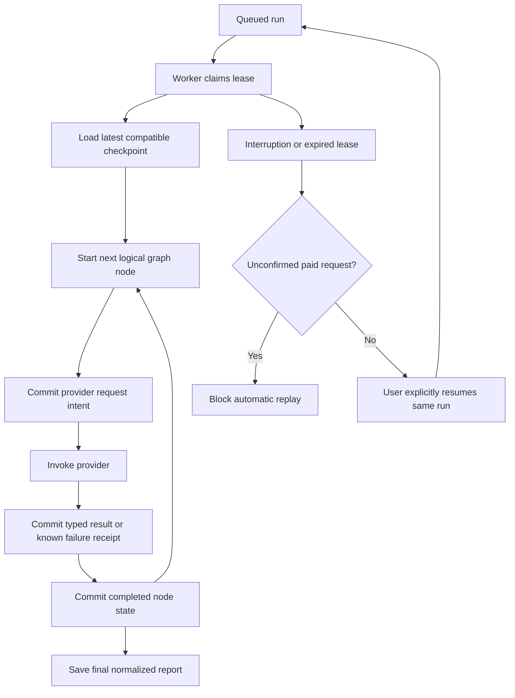

# Research recovery, streaming, operations and account export

This update adds five capabilities to the existing authenticated API and React
dashboard. It preserves the CLI, normalized research tables, quotas, and separate
worker. No provider calls are needed for the automated checks.

## Use the features

1. **Resume:** open a failed investigation and choose **Resume research** when a
   compatible safe checkpoint exists. The same run returns to the queue. If a
   provider request has an unknown outcome, the page explains why resume is
   blocked instead of silently repeating potentially paid work.
2. **Live progress:** active investigations connect to the authenticated SSE
   endpoint automatically. The page shows whether live updates are connected;
   existing polling continues as a fallback during disconnects.
3. **Provider/allowance messages:** provider failures and quota problems appear
   separately from evidence-quality results. Submission errors include safe,
   actionable messages and retry timing when supplied by the server. Missing
   evidence does not mean the provider was available or the topic is unanswerable.
4. **Administration:** explicitly authorized accounts get an **Administration**
   navigation item with queue counts, recent run metadata, failures, unknown
   provider outcomes and spending/wait alerts.
5. **Account export:** in **Usage & account**, choose optional UTC research dates
   and **Download account ZIP**. It contains your profile, owned research,
   sources, sanitized Markdown reports and retained numeric usage.

## Grant administrator access locally

Register the intended account first. From the project root, with PostgreSQL running:

```powershell
.\.venv\Scripts\python.exe -m deepresearch_ai.db set-admin --email "your-account@example.com"
# Revoke access when needed:
.\.venv\Scripts\python.exe -m deepresearch_ai.db set-admin --email "your-account@example.com" --revoke
```

Refresh the browser after a grant to load the navigation item. Every admin API
request checks the current database-backed session/role, so revocation takes
effect without waiting for a cookie to expire. Signup cannot set `is_admin`, and
the first registered account is not promoted automatically. This command is
trusted local operator tooling; there is no public role-grant endpoint.

The administrator view omits research topics, instructions, source content,
user emails, provider credentials and raw SDK exceptions. It is read-only.
Alerts are displayed inside the dashboard; this feature sends no email, SMS or
other external messages.

## How recovery works



The application saves typed state before and after each logical node. A completed
node resumes at the appropriate next graph node, including bounded research retry
routes. An interrupted node may run again, but committed provider results are
reused at their original call positions instead of invoking those requests again.
Receipts contain a request digest, typed result or safe failure fields, and usage
measurements. They do not store raw SDK errors, API keys or unparsed model output.

Before dispatching a request, the worker commits an intent. If the process dies
after dispatch but before its receipt is saved, there is no general way to prove
whether the provider completed or billed it. A pending/unknown LLM or search
request therefore **blocks resume**. Starting a new investigation is an explicit
new admission that can incur new provider charges; it does not resolve the old
request or promise a refund. This is not an exactly-once guarantee from providers.

Ordinary page retrieval results are cached too. An interrupted unpaid page fetch
can be attempted again within the original page/time limits. Its unconfirmed
duration is conservatively charged one page deadline. Successful cached page
fetches preserve recorded text, URLs and retrieval dates.

Other safeguards:

- Checkpoint/receipt writes use the same owner and unexpired-lease fence as report
  writes. Deleted/cancelled runs and expired workers cannot save late results.
- Resume requires ownership, CSRF validation, a failed run and an available active
  slot. Completed/cancelled runs and old runs without checkpoints cannot resume.
- `RESEARCH_MAX_RESUMES` defaults to **2**. Resumes do not create new submissions
  or reset token/cost ceilings; they reuse the original retained reservation.
- Token/search/model/page counts and known active elapsed time survive recovery.
  Downtime between workers is excluded from the active processing deadline.
- Original model/provider/research settings and configured pricing are retained
  without credentials. The worker must match the original mock/real mode before
  SDK setup. Credentials come from the current environment.
- Workflow version and request-digest mismatches block unsafe replay. Change the
  checkpoint version when deploying incompatible state/routing changes.
- Normal configured transient retries remain bounded attempts, each counted in
  budgets. A timeout/unknown paid outcome in durable execution is paused rather
  than automatically retried as if it were certainly unbilled.

The sequential `StateGraph` still uses the current `START`, `END` and `compile()`
APIs. This MVP uses application-owned node checkpoints and receipts in the
existing SQLAlchemy database; it does not claim to implement LangGraph's native
checkpointer protocol, arbitrary rewind/time travel or parallel-node recovery.
This keeps lease fencing, ownership, deletion and accounting in one database.
LangGraph's [persistence documentation](https://docs.langchain.com/oss/python/langgraph/persistence)
describes its native checkpointer option for a future expansion.

## Live progress transport

`GET /research/{id}/events` uses Server-Sent Events with the existing HttpOnly
session cookie. The server rechecks session validity and ownership during the
stream, sends progress snapshots only when they change, and ends on a terminal
state, deletion or revoked session. No credentials are placed in event URLs.

Connections are bounded by `PROGRESS_STREAM_SECONDS` (25 seconds by default),
with heartbeat comments and browser reconnection. `Last-Event-ID` avoids sending
an unchanged active snapshot again; this is current-state recovery, not a complete
event-history replay. The server reads durable state every half second, so a
separate worker process can publish progress through normal database writes.
React refreshes run/source data on events and retains polling as a fallback.

When deploying behind a proxy, preserve the event-stream MIME type and disable
response buffering for this endpoint. Reconnection is expected; test your actual
proxy timeout and HTTPS cookie behavior before public deployment.

## Operations and spending alerts

The operations view shows queued/running/completed/failed/cancelled counts,
oldest queued wait, currently failed jobs updated in the last 24 hours,
insufficient reports completed in that window, and unknown paid-call outcomes.
The run list supports status filtering and pagination.

Spending values come from retained per-user accounting, including numeric records
for deleted research. Estimated/reserved exposure includes conservative failure
charges and open reservations; it is **not a provider invoice**. Missing pricing
is flagged and never presented as a complete zero-cost total. Account deletion
removes that account's accounting, so this dashboard is not a billing ledger for
deleted accounts or an external provider-wide spending cap.

```dotenv
ADMIN_DAILY_SPEND_ALERT_USD=10
ADMIN_QUEUE_ALERT_SECONDS=120
```

Thresholds are configurable, not model prices. Set the provider rates described
in [the quota guide](account_features.md#optional-estimated-cost-limits) to get
cost estimates. The original UTC admission-day accounting policy still applies.

## Export contents and limits

The ZIP includes:

- `account.json`: public profile and account creation date.
- `research/{run_id}/run.json`: owned run metadata and its structured report when available.
- `research/{run_id}/sources.json`: recorded sources, including partial results.
- `research/{run_id}/report.md`: sanitized Markdown for available reports.
- `usage/{entry_id}.json`: numeric accounting, including retained entries from deleted research.
- `README.txt`: contents and handling notes.

Exports exclude password hashes, session/CSRF tokens, provider/database secrets,
idempotency keys/digests, internal checkpoints and provider receipts. Source text
remains untrusted data. Research date filters are inclusive UTC days; the usage
section includes all retained accounting and is not date-filtered.

PostgreSQL export reads use a repeatable-read snapshot. A spooled temporary file
limits memory use, and `ACCOUNT_EXPORT_MAX_BYTES` defaults to 20,000,000 bytes
for both uncompressed contents and the resulting ZIP. An oversized export returns
a safe `413 export_too_large`; narrow its research dates. Files close after the
download or on errors. This is a bounded synchronous export, not a durable export
job for arbitrarily large accounts.

## API and migration

| Endpoint | Result |
| --- | --- |
| `POST /research/{id}/resume` | `202`, same run queued; requires CSRF and safe checkpoint |
| `GET /research/{id}/events` | Authenticated, user-scoped `text/event-stream` |
| `GET /admin/overview` | Typed aggregate counts, estimates and in-app alerts; admin only |
| `GET /admin/runs?status=failed&limit=50&offset=0` | Admin metadata list without topics or source content |
| `GET /account/export?created_from=YYYY-MM-DD&created_to=YYYY-MM-DD` | Private ZIP attachment; filters optional |

The additive migration is `df6050eb8a85`. It adds `research_checkpoints`,
`provider_calls`, an administrator flag, resume count and safe failure code.
Execution snapshots/receipts use versioned JSON as operational recovery artifacts;
users, sources, evidence, claims, reports and citations remain normalized in their
existing tables. Deleting a run cascades to its checkpoints and receipts.

For another checkout/database, migrate before starting services:

```powershell
.\.venv\Scripts\python.exe scripts/postgres_local.py start
.\.venv\Scripts\python.exe -m deepresearch_ai.db upgrade
```

Then use the [existing startup instructions](auth_postgres.md#start-on-this-machine).
Rebuild React if serving it through FastAPI. No real provider calls are required
for development; keep `MOCK_MODE=true` in both the API and worker environments.
Vite now proxies `/admin` alongside `/account`, `/auth`, `/research` and `/health`.

Main files: `storage/recovery.py` (checkpoint/receipt persistence),
`services/recovery.py` (safe control flow), `storage/operations.py` (summaries and
archives), `api/events.py` (SSE), `frontend/src/events.ts` (stream lifecycle),
`components/AdminView.tsx` and `components/AccountExport.tsx` (dashboard views).

Validation: **510 Python tests passed**, **9 PostgreSQL integration tests passed
separately**, and **54 React tests passed**. TypeScript checking, the production
Vite build and the isolated HTTP demo passed. The demo verifies SSE, account ZIP
export and explicit temporary administrator authorization with mocked providers.
No visual browser verification is claimed.
